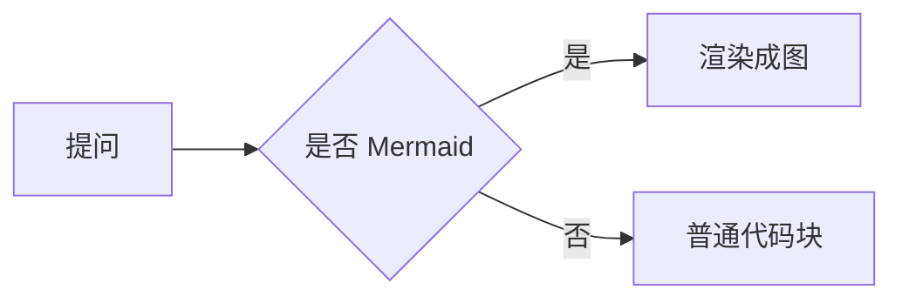

# dsh-flowchart

在 [DeepSeek Harness](https://github.com/deepseek-ai/deepseek-harness) 的聊天里，把 **Mermaid 代码块自动渲染成可交互的图表**——无需改变模型输出习惯，也不用任何服务端。

> A DeepSeek Harness client plugin that renders Mermaid code blocks in chat as interactive diagrams.

## 功能

- 自动识别聊天中的 Mermaid 代码块并就地渲染成图表（历史消息与新消息都生效）。
- 工具栏：**放大 / 缩小 / 适应页面 / 复制图片 / 下载 SVG / 全屏查看 / 源码切换**。
- **复制图片**：以 2× 分辨率导出 PNG 到剪贴板，可直接粘贴到 QQ、微信等聊天窗口分享；在源码视图下则复制源码文本。
- **全屏**：`滚轮`缩放（以鼠标位置为中心）、`左键拖动`平移，`Esc` 退出。
- 跟随 Harness 主题（明/暗）自动重渲染。
- Mermaid 引擎（~1MB gzip）作为独立分块**懒加载**：首次出现图表时才下载，基础插件很小。
- 渲染失败时**安全降级**为原始代码块，不影响其它内容。

## 支持的图种

Mermaid 11 的主流类型：流程图、时序图、类图、状态图、ER 图、甘特图、饼图、Journey、Git 图、思维导图、时间线、象限图、Sankey、xychart、block、C4 等。

## 安装

前提：已安装 DeepSeek Harness，且启用插件管理器。

任选其一：

用 GitHub 仓库安装：

```bash
dsh plugin add github:jesongit/dsh-flowchart
```

本地开发安装：

```bash
git clone https://github.com/jesongit/dsh-flowchart.git
dsh plugin add ./dsh-flowchart
```

> 目前未发布到 npm；发布后可使用 `dsh plugin add dsh-flowchart`。

安装后可在 **设置 → 插件** 中看到「Mermaid 图表 / Mermaid Diagrams」。首次出现图表时会自动加载 Mermaid 引擎。

## 使用

发送包含 ` ```mermaid ` 代码块的消息即可，例如：

````markdown

````

## 实现说明与限制

- Harness 的 Markdown 渲染器没有代码围栏的插件钩子，本插件通过观察已渲染的对话 DOM 来增强代码块；若未来 Harness 的 DOM 结构调整导致匹配不到，会安全地保持原始代码块。
- 所有渲染都在浏览器本地完成，**不联网、不上传任何内容**；Mermaid 引擎随插件本地分发。
- 对超宽/超大图，自适应会等比缩小以适应一屏；可用「放大」或「全屏」查看细节。

## 许可证

MIT（见 [LICENSE](LICENSE)）。内置 Mermaid 的第三方许可见 [THIRD-PARTY-NOTICES](THIRD-PARTY-NOTICES)。
